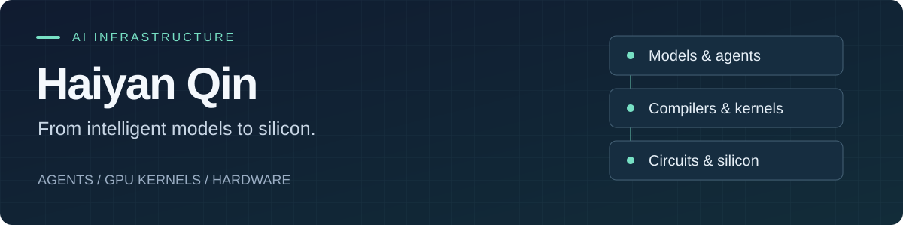

# 你好，我是 Haiyan Qin

**AI 基础设施研究者 · 北京航空航天大学博士研究生**

[个人网站](https://qhy991.github.io/) · [Google Scholar](https://scholar.google.com/citations?user=zzmYq9QAAAAJ&hl=en) · [联系我](mailto:haiyanq@buaa.edu.cn)

**简体中文** · [English](README.md)

我研究如何让 **AI Agent 生成并优化可执行的系统与硬件**，连接模型、GPU Kernel、编译器与电路设计。目前在北京航空航天大学攻读集成电路方向博士学位（2023 至今）。

- **AI + EDA** — RTL 生成、多模态电路理解与多 Agent 设计。
- **AI 系统** — GPU Kernel 生成与优化、编译器协同优化、可复现评测。
- **AI 硬件** — 存内计算、FPGA 部署与电路优化。

> **当前重点：** 把专家的 Kernel 优化方法转化为可执行工作流，让生成、性能分析与评测形成闭环。

## 代表项目

从可运行的工具，到支撑研究的论文与系统资料。

| 项目 | 可以在这里找到什么 |
| :-- | :-- |
| **[Awesome-Kernel-Workflows](https://github.com/qhy991/Awesome-Kernel-Workflows)** | 将专家级 Kernel 优化方法封装为可运行的 Agent 工作流。 |
| **[open-cake-ir](https://github.com/qhy991/open-cake-ir)** | Agent 驱动的 GPU Kernel 与编译器协同进化，包含类型化 IR、结构化反馈与验证产物。 |
| **[Awesome-LLM-Kernel-Agent](https://github.com/qhy991/Awesome-LLM-Kernel-Agent)** | LLM 驱动 Kernel 生成与优化的论文、系统和评测资料。 |
| **[Awesome-LLM-Circuit-Agent](https://github.com/qhy991/Awesome-LLM-Circuit-Agent)** | LLM 驱动 RTL 与模拟电路生成的学术工作。 |
| **[Awesome-MegaKernel](https://github.com/qhy991/Awesome-MegaKernel)** | 整模型 Kernel、常驻运行时与深度融合的 LLM 系统。 |
| **[gpu-infra](https://github.com/qhy991/gpu-infra)** | 面向 Agent 的 Kernel 评测、GPU 调度与实验依据管理。 |

<b>更多工具与硬件项目</b>

- [**agent-gpu-broker**](https://github.com/qhy991/agent-gpu-broker) — 单机 GPU 队列，支持共享、独占与原子多卡调度。
- [**ROCm-KernelWiki-Q**](https://github.com/qhy991/ROCm-KernelWiki-Q) — 面向 AMD ROCm / CDNA 的 Kernel 优化知识图谱。
- [**Digital-CIM**](https://github.com/qhy991/Digital-CIM) — Verilog 实现的数字存内计算设计。
- [**Scientific-Figure-Design**](https://github.com/qhy991/Scientific-Figure-Design) — 论文级科研配图工具。

## 代表研究

**[CircuitWeave](https://arxiv.org/abs/2607.23523)** · arXiv 预印本，2026 
面向可执行多模态 RTL 生成的拓扑—行为对齐，将电路图与自然语言规格连接起来。

**[ReasoningV](https://arxiv.org/abs/2504.14560)** · ICAIS 2025 · [代码](https://github.com/BUAA-CLab/ReasoningV) 
通过自适应混合推理提升 Verilog 代码生成效率。

**[CircuitMind](https://arxiv.org/abs/2504.14625)** · arXiv 预印本，2025 · [代码](https://github.com/BUAA-CLab/CircuitMind) 
探索多 Agent 协作与群体智能在电路生成中的应用。

<b>更多论文 · DAC、存内计算与 FPGA</b>

| 年份 | 会议 / 期刊 | 论文 | 链接 |
| :-- | :-- | :-- | :-- |
| 2025 | **DAC 2025** | 面向电路设计的多 Agent 良率分析 | [DBLP](https://researchr.org/publication/QinKZKX25) |
| 2025 | **DAC 2025** | 精度感知的贝叶斯良率优化 | — |
| 2025 | **DAC 2025** | 基于 Crossbar 的多核 CIM 系统权重映射与资源调度 | — |
| 2025 | Integrated Circuits and Systems | 基于高阻 SOT 器件的存内计算宏，面向边缘 AI 推理 | [DOI](https://doi.org/10.23919/ICS.2025.3567939) |
| 2023 | IEEE AICAS 2023 | 面向嵌入式 FPGA 部署的微小神经网络搜索 | [DBLP](https://researchr.org/publication/QinZBK23) |

[完整论文列表](https://qhy991.github.io/publications.html) · [Google Scholar](https://scholar.google.com/citations?user=zzmYq9QAAAAJ&hl=en)

## 常用技术

**Kernel 与系统** · `CUDA` `Triton` `C++` `Python` `ROCm` `Linux` 
**模型与编译** · `PyTorch` `SGLang` `llama.cpp` `TVM` 
**硬件设计** · `Verilog` `FPGA` `Computing-in-Memory`

---

欢迎交流 **Kernel 优化、AI 系统与智能硬件设计**。 
[haiyanq@buaa.edu.cn](mailto:haiyanq@buaa.edu.cn) · [研究笔记](https://qhy991.github.io/blog.html)
